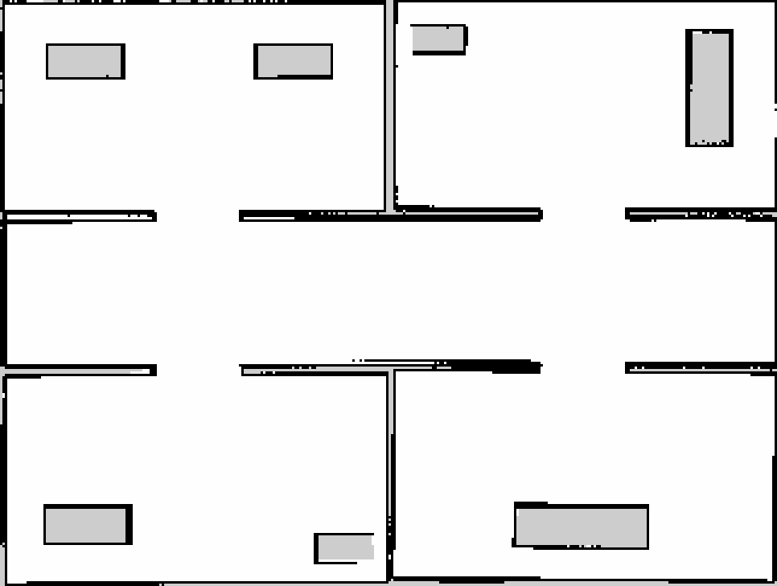
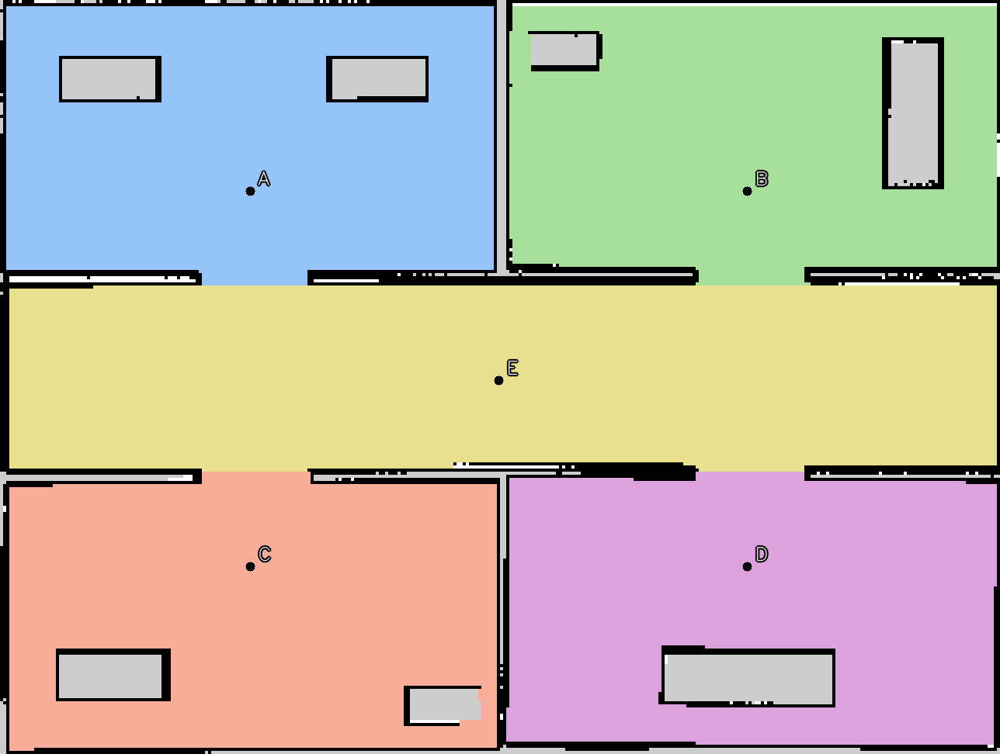

# TurtleBot 4 — Phân vùng bản đồ và điều hướng bằng giọng nói

## 1. Các package

| Package | Chức năng / node chính |
| --- | --- |
| `robot_description` | URDF, mesh và cảm biến TurtleBot 4. |
| `robot_sim` | Mở Gazebo, spawn robot và bridge `/cmd_vel`, `/odom`, `/scan`, `/clock`. |
| `robot_mapping` | SLAM Toolbox và lưu bản đồ. |
| `robot_navigation` | Nạp map, định vị AMCL và chạy Nav2. Bản đồ lưu trong `maps/`. |
| `robot_semantic` | `segment_map` phân vùng; `semantic_map_node` hiển thị vùng và điểm đích trên RViz. |
| `robot_voice` | `speech_recognition_node` đọc micro; `text_command_node` nhập câu lệnh trong terminal; `voice_navigation_node` phân tích lệnh và gửi action `/navigate_to_pose`. |

Luồng chính: **micro → Whisper → `/voice/text` → phân tích vùng → Nav2**.

## 2. Cài đặt

Yêu cầu Ubuntu 22.04, ROS 2 Humble, Gazebo Fortress

```bash
mkdir -p ~/workspaces/turtlebot4_ws
cd ~/workspaces/turtlebot4_ws
git clone -b assignment_7 https://github.com/TNSang25/Turtlebot4.git src
```

```bash
sudo apt update
sudo apt install python3-colcon-common-extensions python3-venv python3-pip \
  python3-opencv python3-numpy python3-yaml python3-pil libportaudio2 \
  ros-humble-ros-gz ros-humble-xacro ros-humble-robot-state-publisher \
  ros-humble-rviz2 ros-humble-slam-toolbox \
  ros-humble-navigation2 ros-humble-nav2-bringup

cd ~/workspaces/turtlebot4_ws
python3 -m venv --system-site-packages .venv-voice
.venv-voice/bin/python -m pip install -r src/robot_voice/requirements.txt
python3 src/robot_voice/scripts/download_model.py

source /opt/ros/humble/setup.bash
PYTHONNOUSERSITE=1 colcon build --symlink-install
```

## 3. World

Chạy `world:=semantic_building`. World tự xây dựng, chạy offline, gồm bốn
phòng có cửa nối với hành lang; có bàn/tủ, màu sàn và nhãn tên trong Gazebo.
Kích thước trong nhà **16 × 12 m**, hành lang rộng **3 m**, cửa rộng **1,8 m**.
World: `robot_sim/worlds/semantic_building.sdf`;
[sơ đồ bố trí](robot_sim/maps/semantic_building_layout.png).

**Ba loại dữ liệu bản đồ:**

| Dữ liệu | File | Sử dụng |
| --- | --- | --- |
| Bản đồ gốc từ SLAM | `robot_navigation/maps/semantic_building.yaml` + `.pgm` | YAML chứa độ phân giải, gốc tọa độ và đường dẫn ảnh PGM; `map_server` nạp thành `/map` cho AMCL và Nav2. |
| Bản đồ phân vùng | `robot_semantic/maps/semantic_building_regions_labels.png` và `semantic_building_regions_preview.png` | `labels.png` lưu ID vùng theo từng pixel; `preview.png` tô màu và đánh dấu A–E để kiểm tra. Ảnh màu không thay thế map gốc. |
| Thông tin khu vực | `robot_semantic/config/semantic_building_regions.yaml` | Chứa ID, tên, bí danh, `goal: {x, y, yaw}`, đường dẫn ảnh nhãn và fingerprint map. Bộ nhận lệnh tra file này để gửi đích cho Nav2. |

<!-- Có thể dùng ảnh chụp RViz thay cho các ảnh preview có sẵn. -->
| Bản đồ gốc | Bản đồ phân vùng A–E |
| --- | --- |
|  |  |


**Điểm đích đang lưu trong file khu vực** (frame `map`, mét/radian):

| ID | Khu vực | `(x, y, yaw)` |
| --- | --- | --- |
| A | Phòng học | `(-4.005, 3.025, 0)` |
| B | Phòng thí nghiệm | `(3.995, 3.025, 0)` |
| C | Văn phòng | `(-4.005, -3.025, 0)` |
| D | Phòng họp | `(3.995, -3.025, 0)` |
| E | Hành lang | `(-0.005, -0.025, 0)` |

Bố trí gốc: `robot_sim/config/semantic_building.yaml`. Tên, bí danh, điểm đích
dự kiến (`seed`) và giới hạn (`bounds`) dùng **khi tạo phân vùng** nằm trong
`robot_semantic/config/semantic_building_seeds.yaml`. Đây là file đầu vào;
`semantic_building_regions.yaml` là kết quả dùng **khi chạy điều hướng**.
Chương trình lọc ô trống, mở hình thái 3×3 rồi lan nhãn từ các seed trong
giới hạn từng vùng; không lan qua tường hoặc ô chưa biết. Tên phòng được cấu
hình sẵn, không tự suy luận từ hình dạng map.

Khi quét lại, bắt đầu robot ở `(0, 0, yaw=0)`; kiểm tra và chỉnh `seed`,
`bounds` theo frame `map` trước khi tạo lại phân vùng. Đã có sẵn map và file
vùng khớp nhau, có thể chạy thẳng phần 5. Phần 4 chỉ cần khi quét lại hoặc
sửa world. Không dùng map `demo` cho world này.

Nếu sửa bố trí/tên trong `semantic_building.yaml`, tạo lại world, nhãn sàn
và seed bằng `python3 src/robot_sim/scripts/generate_semantic_building.py`.

## 4. Chạy SLAM và lưu map mới

Chuẩn bị **mỗi terminal**:

```bash
cd ~/workspaces/turtlebot4_ws
source /opt/ros/humble/setup.bash
source install/setup.bash
export ROS_DOMAIN_ID=69
```

**Terminal 1 — Simulation:**

```bash
ros2 launch robot_sim sim.launch.py world:=semantic_building \
  x:=0.0 y:=0.0 yaw:=0.0 enable_camera:=false
```

**Terminal 2 — SLAM Toolbox và RViz:**

```bash
ros2 launch robot_mapping mapping.launch.py loop_closing:=false
```

**Terminal 3 — Teleop để quét:**

```bash
ros2 run robot_node teleop_keyboard --ros-args \
  -p linear_speed:=0.25 -p angular_speed:=0.45
```

**Terminal 4 — Lưu riêng map mới:**

```bash
ros2 launch robot_mapping save_map.launch.py \
  map_name:=$PWD/src/robot_navigation/maps/semantic_building
```

Sau khi có `semantic_building.yaml` và `.pgm`, tạo vùng từ đúng map đó:

```bash
ros2 run robot_semantic segment_map \
  --map src/robot_navigation/maps/semantic_building.yaml \
  --seeds src/robot_semantic/config/semantic_building_seeds.yaml \
  --output src/robot_semantic/config/semantic_building_regions.yaml
```

## 5. Chạy điều hướng bằng micro

Luồng: **micro → `speech_recognition_node` (Whisper) → `/voice/text`
→ `voice_navigation_node` (tra tên trong YAML, lấy tọa độ)
→ `/navigate_to_pose` → Nav2 → `/cmd_vel` → Gazebo**.

Sau khi cài đặt ở phần 2, mở bốn terminal. **Trong mỗi terminal**, chạy:

```bash
cd ~/workspaces/turtlebot4_ws
source /opt/ros/humble/setup.bash
source install/setup.bash
export ROS_DOMAIN_ID=69
```

**Terminal 1 — Mở lại đúng world:**

```bash
ros2 launch robot_sim sim.launch.py world:=semantic_building \
  x:=0.0 y:=0.0 yaw:=0.0 enable_camera:=false
```

**Terminal 2 — Load map và AMCL:**

```bash
ros2 launch robot_navigation localization.launch.py \
  map:=$PWD/src/robot_navigation/maps/semantic_building.yaml \
  set_initial_pose:=true \
  initial_pose_x:=0.0 initial_pose_y:=0.0 initial_pose_yaw:=0.0
```

Pose trên phù hợp khi vừa mở simulation ở `(0, 0, 0)`. Kiểm tra `/scan` trùng
tường trên RViz; nếu robot đang ở chỗ khác, dùng **2D Pose Estimate** đặt lại
đúng vị trí/hướng hiện tại. Không chạy SLAM cùng AMCL.

**Terminal 3 — Nav2:**

```bash
ros2 launch robot_navigation navigation.launch.py
```

**Terminal 4 — Micro, nhận dạng và gửi goal:**

```bash
ros2 launch robot_voice voice_navigation.launch.py \
  regions_file:=$PWD/src/robot_semantic/config/semantic_building_regions.yaml \
  python_executable:=$PWD/.venv-voice/bin/python \
  model_path:=$PWD/src/robot_voice/models/faster-whisper-small
```

Giữ cả bốn terminal chạy. Chờ `Microphone ready` và trạng thái điều hướng
`ready`. Nói một câu, ngừng khoảng 0,8 giây và chờ dòng `HEARD`:

- **“Đi đến phòng học.”** → A.
- **“Đi đến phòng thí nghiệm.”** → B.
- **“Đi đến văn phòng.”** → C.
- **“Đi đến phòng họp.”** → D.
- **“Đi đến hành lang.”** → E.
- **“Di chuyển từ phòng học đến phòng họp.”** → qua A rồi D nếu chưa ở A.
- **“Dừng lại.”** → hủy hành trình sau khi câu nói được nhận dạng.


Chọn micro khác bằng `device:=<index hoặc tên>`. Liệt kê thiết bị:

```bash
.venv-voice/bin/python -m sounddevice
```

Theo dõi:

```bash
ros2 topic echo /voice/text
ros2 topic echo /voice/navigation_status
ros2 topic echo /voice/speech_status
```

## 6. Thử nhận lệnh và Nav2 bằng cách nhập chữ

Chạy simulation, localization và Nav2 như terminal 1–3 ở phần 5. Thay terminal
micro bằng hai terminal sau; không cần kích hoạt venv hoặc tải Whisper.

**Terminal 4 — Bộ nhận lệnh và gửi goal:**

```bash
ros2 launch robot_voice voice_navigation.launch.py speech:=false \
  regions_file:=$PWD/src/robot_semantic/config/semantic_building_regions.yaml
```

**Terminal 5 — Nhập câu lệnh:**

```bash
ros2 run robot_voice text_command_node
```

Chờ trạng thái `ready`, gõ `Đi đến phòng học` rồi Enter. Có thể nhập tên các
phòng, `Di chuyển từ phòng học đến phòng họp`, hoặc `Dừng lại`. `:help` hiện
hướng dẫn; `:q`/Ctrl+C gửi dừng nếu có hành trình đang chạy rồi thoát.

Luồng: **bàn phím → `/voice/text` → bộ phân tích hiện có → `/navigate_to_pose`
→ Nav2 → `/cmd_vel`**. Tên lạ, đích không an toàn và lệnh mới khi đang bận được
xử lý như khi dùng micro. Không chạy node micro cùng lúc với chế độ nhập chữ.

Nếu chỉ muốn gửi một câu trực tiếp:

```bash
ros2 topic pub --once /voice/text std_msgs/msg/String "{data: 'Đi đến phòng thí nghiệm'}"
ros2 topic pub --once /voice/text std_msgs/msg/String "{data: 'Dừng lại'}"
```

Map cũ vẫn dùng được: `world:=demo`, map `robot_navigation/maps/my_map.yaml`,
file vùng `robot_semantic/config/regions.yaml` (nhãn A/B/C cũ, khác world mới).
