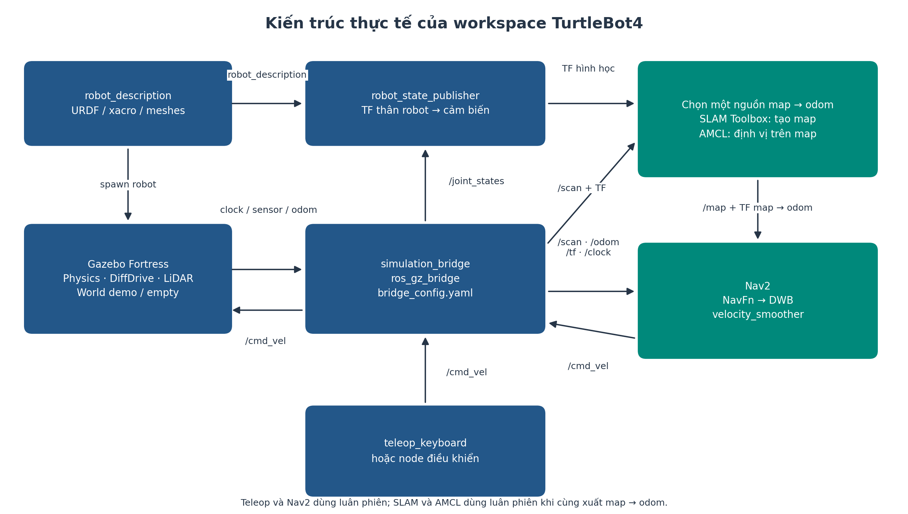
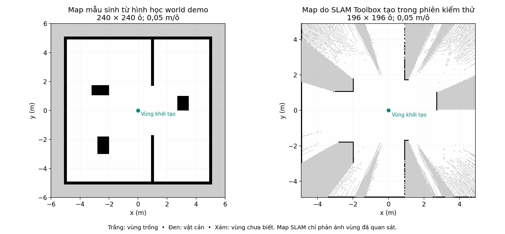
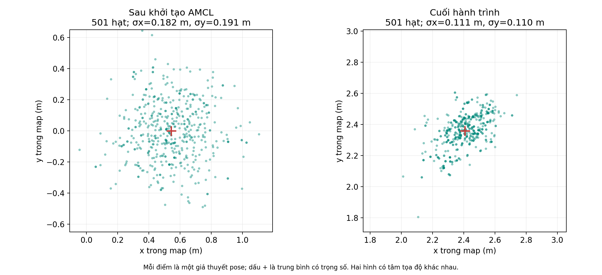
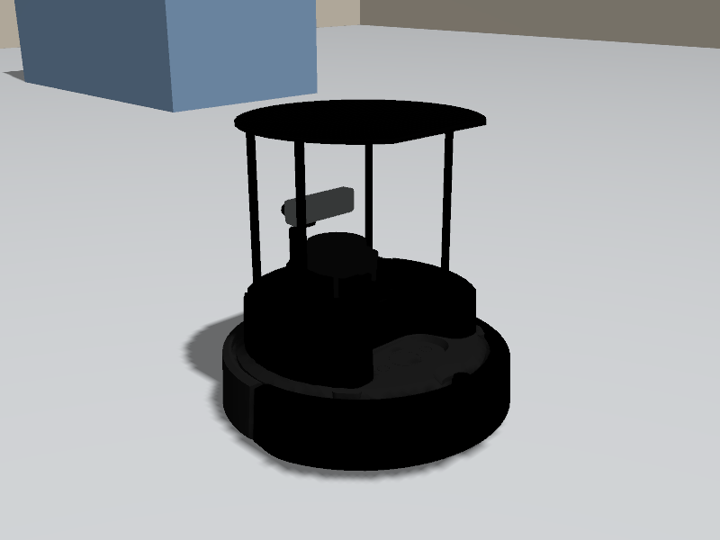
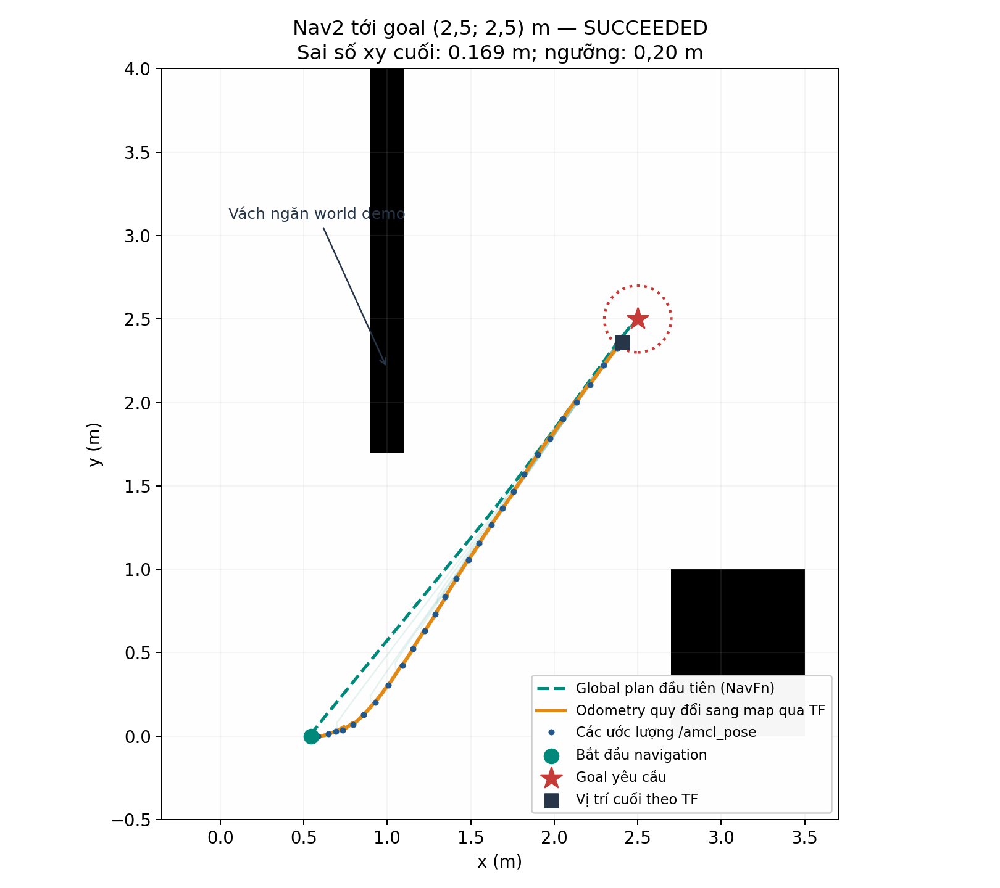
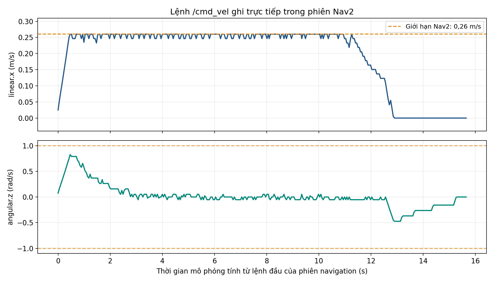

# Mô phỏng, xây dựng bản đồ và điều hướng TurtleBot4

**Hệ thống:** Ubuntu 22.04, ROS 2 Humble, Gazebo Fortress, SLAM Toolbox và Nav2.

**Phạm vi:** mô tả theo code và cấu hình hiện có trong workspace `turtlebot4_ws`. Hình robot được chụp từ camera trong Gazebo; các đồ thị bản đồ, định vị, đường đi và vận tốc được tạo từ dữ liệu chạy thật ngày 13/10/2026.

**Cập nhật ngày 14/10/2026:** tách localization và navigation thành hai launch độc lập; lưu map SLAM trong `robot_navigation/maps/`; bổ sung hướng dẫn chuyển bước và kiểm tra trạng thái. Các hình và số liệu của phiên ghi kết quả ngày 13/10/2026 được giữ nguyên.

## 1. Cấu trúc chương trình

Chương trình chia thành năm package theo chức năng. Mô tả cơ khí tách khỏi môi trường mô phỏng; mapping, localization và navigation có launch riêng; node điều khiển phát message chuẩn ROS 2. Cách chia này cho phép thay world, chỉnh cấu hình SLAM hoặc thay thuật toán navigation mà không phải sửa toàn bộ mô hình robot.

```text
turtlebot4_ws/
└── src/
    ├── README.md
    ├── robot_description/
    │   ├── urdf/          # Xacro TurtleBot4, Create 3 và adapter Gazebo
    │   ├── meshes/        # 11 mesh DAE chính thức
    │   ├── config/        # Cấu hình cảm biến và DiffDrive
    │   ├── launch/        # Xem mô hình robot
    │   └── rviz/
    ├── robot_sim/
    │   ├── worlds/        # demo.sdf, empty.sdf
    │   ├── maps/          # Map mẫu tương ứng world demo
    │   ├── config/        # bridge_config.yaml, demo_layout.yaml
    │   ├── launch/        # Gazebo, spawn, bridge, sim
    │   └── scripts/       # Sinh world/map, kiểm tra mô phỏng
    ├── robot_mapping/
    │   ├── config/        # slam.yaml
    │   ├── launch/        # mapping và save_map
    │   └── rviz/
    ├── robot_navigation/
    │   ├── maps/          # Map SLAM đã lưu: YAML và PGM
    │   ├── config/        # nav2.yaml
    │   ├── launch/        # localization.launch.py, navigation.launch.py
    │   └── rviz/
    ├── robot_node/
    │   ├── robot_node/   # Teleop, bộ lọc vận tốc, xử lý dừng
    │   ├── resource/     # Marker đăng ký package
    │   └── test/
    └── docs/             # Báo cáo Markdown/PDF, hình, dữ liệu và script xuất PDF
```

Bốn package mô tả/mô phỏng/mapping/navigation dùng `ament_cmake`, khai báo bằng `package.xml` và `CMakeLists.txt`. `robot_node` dùng `ament_python`, với `setup.py`, `setup.cfg` và module Python. Các thư mục `licenses/` chứa giấy phép và attribution.

Mô hình sử dụng TurtleBot4 Standard và đế iRobot Create 3 từ các commit Humble cố định. Mô tả có 49 link, 48 joint; geometry, collision và inertia được giữ từ upstream. Adapter của workspace bổ sung các plugin Gazebo cho drive và sensor. Các file được tải riêng từ GitHub, không clone repo.



*Hình 1. Kiến trúc chương trình. SLAM và AMCL là hai nguồn thay thế cho TF `map → odom`; teleop và Nav2 được dùng luân phiên để điều khiển.*

Luồng điều khiển hiện tại đi trực tiếp qua bridge:

```text
Node điều khiển / Nav2
    → /cmd_vel ở ROS 2
    → ros_gz_bridge/parameter_bridge
    → /cmd_vel ở Gazebo
    → DiffDrive → bánh xe → chuyển động robot
```

Một node `simulation_bridge` đọc toàn bộ `robot_sim/config/bridge_config.yaml`. Không có relay watchdog hoặc topic trung gian `/cmd_vel_sim`. ROS và Gazebo có thể dùng cùng tên topic vì chúng thuộc hai hệ thống truyền thông khác nhau.

## 2. Các package và node chính

### 2.1. Vai trò của các package

| Package | Vai trò và file chính |
| --- | --- |
| `robot_description` | Cung cấp `urdf/turtlebot4.urdf.xacro`, mesh, các frame và thông số simulator trong `config/simulation.yaml`. |
| `robot_sim` | Mở world, spawn robot và bridge ROS–Gazebo. Launch tổng hợp là `launch/sim.launch.py`. |
| `robot_mapping` | Chạy SLAM Toolbox async với `config/slam.yaml`; `save_map.launch.py` lưu occupancy map vào `robot_navigation/maps/`. |
| `robot_navigation` | Lưu map SLAM, launch riêng cho AMCL/map server và Nav2; Nav2 dùng map/TF từ AMCL hoặc SLAM. Cấu hình trong `config/nav2.yaml`. |
| `robot_node` | Chạy `teleop_keyboard`; đọc bàn phím và phát `geometry_msgs/msg/Twist` trên `/cmd_vel`. |

Package là đơn vị tổ chức code và dependency. Node là tiến trình ROS đang thực thi. Một package có thể chỉ chứa cấu hình/launch để khởi động node do package ROS chính thức cung cấp.

### 2.2. Các node và plugin thực thi

| Thành phần | Chức năng |
| --- | --- |
| Gazebo server | Mô phỏng vật lý, world, robot, va chạm và cảm biến. |
| `robot_state_publisher` | Từ URDF và `/joint_states`, xuất TF thân robot, cảm biến và bánh xe. |
| `ros_gz_sim/create` | Spawn entity từ `/robot_description`; đây là tiến trình khởi tạo, có thể thoát sau khi spawn thành công. |
| `simulation_bridge` | Executable `ros_gz_bridge/parameter_bridge`; chuyển đổi message ROS và Ignition. |
| `teleop_keyboard` | Điều khiển bằng phím chữ thường `w/s/a/d`, cung `q/e/z/c`, Space dừng. |
| `slam_toolbox` | Chạy `async_slam_toolbox_node`, xây dựng `/map` và hiệu chỉnh `map → odom`. |
| `map_saver` | Chạy `nav2_map_server/map_saver_cli`, ghi ảnh PGM và YAML rồi thoát. |
| `map_server`, `amcl` | Nạp map đã lưu và ước lượng pose robot trên map. |
| `planner_server` | Gọi plugin NavFn để tính global path. |
| `controller_server` | Gọi plugin DWB để chọn vận tốc bám path và tránh vật cản. |
| `bt_navigator` | Điều phối tác vụ điều hướng bằng Behavior Tree và action `NavigateToPose`. |
| `smoother_server` | Cung cấp dịch vụ/action làm mượt path; việc sử dụng phụ thuộc Behavior Tree. |
| `velocity_smoother` | Làm mượt lệnh vận tốc trước khi xuất `/cmd_vel`. |
| `behavior_server` | Cung cấp các hành vi Spin, BackUp, Wait, DriveOnHeading và AssistedTeleop. |
| `waypoint_follower` | Điều phối tác vụ đi qua danh sách waypoint khi được yêu cầu. |
| Lifecycle managers | Configure/activate các node Nav2 theo thứ tự và theo dõi trạng thái. |
| RViz | Hiển thị map, TF, robot, LiDAR, path, particle cloud và nhận thao tác đặt pose/goal. |

`DiffDrive`, `JointStatePublisher`, `Sensors` và `Imu` là **plugin chạy bên trong Gazebo**, không phải các node ROS riêng. Bridge chuyển dữ liệu của chúng sang ROS.

### 2.3. Bốn launch của `robot_sim`

| File launch | Công việc |
| --- | --- |
| `gazebo.launch.py` | Mở Gazebo và world được chọn; thiết lập đường dẫn resource cho mesh. |
| `spawn.launch.py` | Mở rộng xacro, chạy `robot_state_publisher`, gọi `ros_gz_sim/create`. |
| `bridge.launch.py` | Chạy một `parameter_bridge` dùng `bridge_config.yaml`. |
| `sim.launch.py` | Gọi ba launch trên và tùy chọn mở RViz; đây là lệnh mô phỏng thông thường. |

### 2.4. Launch mapping, localization và navigation

| Package / launch | Node được khởi động | Dữ liệu và hiển thị |
| --- | --- | --- |
| `robot_mapping / mapping.launch.py` | `slam_toolbox`, RViz | Xây dựng `/map`, xuất `map → odom`; RViz mặc định bật. |
| `robot_mapping / save_map.launch.py` | `map_saver` | Lưu YAML/PGM từ `/map`, sau đó thoát. |
| `robot_navigation / localization.launch.py` | `map_server`, `amcl`, `lifecycle_manager_localization`, RViz | Nạp map đã lưu và xuất `map → odom`; RViz mặc định bật. |
| `robot_navigation / navigation.launch.py` | Các node planner/controller/BT/behavior/smoother/waypoint và `lifecycle_manager_navigation` | Dùng map/TF từ localization hoặc SLAM; RViz mặc định tắt. |

`map:=...` thuộc launch localization. Launch navigation không còn gọi map server/AMCL và không sử dụng đối số `localization`. Khi navigation hoạt động với AMCL, hai launch phải cùng chạy. Tham số `use_sim_time` mặc định là `true` trong các launch này.

## 3. Các topic chính và hệ tọa độ

### 3.1. Topic cảm biến, trạng thái và điều khiển

| Topic | Kiểu message | Nguồn → nơi sử dụng | Ý nghĩa |
| --- | --- | --- | --- |
| `/cmd_vel` | `geometry_msgs/msg/Twist` | Teleop hoặc Nav2 → bridge → Gazebo | Vận tốc tiến `linear.x` và quay `angular.z`. |
| `/clock` | `rosgraph_msgs/msg/Clock` | Gazebo → các node ROS | Đồng hồ mô phỏng, dùng với `use_sim_time=true`. |
| `/scan` | `sensor_msgs/msg/LaserScan` | LiDAR Gazebo → SLAM, AMCL, costmap | Khoảng cách vật cản theo từng góc quét. |
| `/odom` | `nav_msgs/msg/Odometry` | DiffDrive → Nav2 và node quan sát | Pose và vận tốc tương đối trong frame `odom`. |
| `/joint_states` | `sensor_msgs/msg/JointState` | Gazebo → robot_state_publisher | Trạng thái bánh xe và khớp wheel-drop. |
| `/tf` | `tf2_msgs/msg/TFMessage` | Các nguồn TF → các node | Transform thay đổi theo thời gian. |
| `/tf_static` | `tf2_msgs/msg/TFMessage` | robot_state_publisher → các node | Transform cố định giữa các link. |
| `/robot_description` | `std_msgs/msg/String` | robot_state_publisher → spawn/RViz | URDF đã mở rộng từ xacro. |
| `/imu` | `sensor_msgs/msg/Imu` | Gazebo → node quan sát | Dữ liệu IMU. |
| `/map` | `nav_msgs/msg/OccupancyGrid` | SLAM hoặc map_server → Nav2/RViz | Lưới occupancy 2D. |
| `/pose` | `geometry_msgs/msg/PoseWithCovarianceStamped` | SLAM → node quan sát | Pose từ scan matching khi mapping. |
| `/initialpose` | `geometry_msgs/msg/PoseWithCovarianceStamped` | RViz/người dùng → AMCL | Giả thuyết vị trí và hướng ban đầu, kèm covariance. |
| `/amcl_pose` | `geometry_msgs/msg/PoseWithCovarianceStamped` | AMCL → node quan sát | Pose đã định vị trong frame `map`. |
| `/particle_cloud` | `nav2_msgs/msg/ParticleCloud` | AMCL → RViz/node ghi dữ liệu | Tập giả thuyết pose và trọng số. |
| `/plan` | `nav_msgs/msg/Path` | planner_server → controller/RViz | Global path trong frame `map`. |
| `/local_plan` | `nav_msgs/msg/Path` | DWB → RViz/node quan sát | Quỹ đạo cục bộ được chọn/dự đoán. |
| `/cmd_vel_nav` | `geometry_msgs/msg/Twist` | controller_server → velocity_smoother | Lệnh vận tốc trước bước làm mượt. |

Khi bật `enable_camera:=true`, bridge còn xuất `/camera/image`, `/camera/depth_image` và `/camera/camera_info`, tương ứng `Image`, `Image` và `CameraInfo`. Cấu hình SLAM/AMCL hiện dùng LiDAR và odometry/TF; IMU và camera chưa được ghép vào một bộ lọc định vị trong workspace này.

`/navigate_to_pose` là **action**, không phải một topic vận tốc. Action nhận goal, trả feedback và kết quả. Behavior Tree còn sử dụng các action như `/compute_path_to_pose` và `/follow_path`.

### 3.2. Chuỗi TF

```text
map
 └── odom
      └── base_link
           ├── rplidar_link
           ├── imu_link
           ├── oakd_link → các frame camera/optical
           └── các frame khớp và bánh xe
```

`map` là hệ tọa độ toàn cục; `odom` là hệ tọa độ chuyển động tương đối; `base_link` gắn với thân robot. Odometry cung cấp chuyển động liên tục nhưng có thể tích lũy sai số. SLAM hoặc AMCL hiệu chỉnh `map → odom`. Quan hệ các frame được trình bày trong [REP-105](https://raw.githubusercontent.com/ros-infrastructure/rep/master/rep-0105.rst).

Trong workspace, DiffDrive xuất `odom → base_link`; `robot_state_publisher` xuất các transform phía dưới `base_link`. SLAM và AMCL không được đồng thời xuất `map → odom` cho cùng robot. Mỗi scan có timestamp; TF phải có dữ liệu phù hợp ở timestamp đó, không chỉ tồn tại tên frame.

## 4. Quá trình xây dựng bản đồ

### 4.1. Chạy mapping

Sau khi cài dependency theo `src/README.md`, build workspace:

```bash
cd ~/workspaces/turtlebot4_ws
source /opt/ros/humble/setup.bash
PYTHONNOUSERSITE=1 colcon build --symlink-install
```

Trong mỗi terminal, source ROS và workspace; dùng cùng `ROS_DOMAIN_ID`:

```bash
cd ~/workspaces/turtlebot4_ws
source /opt/ros/humble/setup.bash
source install/setup.bash
export ROS_DOMAIN_ID=69
```

Sau đó chạy theo thứ tự:

```bash
# Terminal 1 — simulation; đợi robot xuất hiện
ros2 launch robot_sim sim.launch.py
# Terminal 2 — SLAM và RViz
ros2 launch robot_mapping mapping.launch.py
# Terminal 3 — điều khiển robot quét môi trường
ros2 run robot_node teleop_keyboard
```

Các lệnh trên chạy ở các terminal riêng. Giữ simulation chạy suốt ba bước. Người vận hành focus terminal teleop và dùng phím chữ thường `w/s` tiến/lùi, `a/d` quay, `Space` dừng. Lái robot đi qua các vùng cần quan sát; workspace hiện chưa có node exploration tự động.

### 4.2. Dữ liệu đi qua hệ thống

1. LiDAR Gazebo phát 640 mẫu/quét ở 10 Hz trên `/scan`; frame là `rplidar_link`.
2. Bridge đưa scan và TF odometry vào ROS. SLAM dùng transform `odom → base_link` và quan hệ với LiDAR để đặt scan vào cùng hệ tọa độ.
3. SLAM lọc scan theo thời gian/chuyển động đã cấu hình, rồi scan matching để hiệu chỉnh pose.
4. Các pose được nối bằng ràng buộc trong pose graph. Khi nhận ra vùng đã đi qua, loop closure có thể thêm ràng buộc để giảm sai lệch tích lũy.
5. Ceres tối ưu pose graph. Dữ liệu quét được chuyển thành occupancy grid và xuất `/map`; transform `map → odom` cập nhật vị trí toàn cục.

Cơ chế pose graph, scan matching, loop closure và serialization được mô tả trong [SLAM Toolbox Humble](https://github.com/SteveMacenski/slam_toolbox/blob/humble/README.md).

Occupancy grid mô tả mức chiếm chỗ của từng ô. Trong ROS, ô chưa biết có giá trị `-1`; vùng đã biết có giá trị occupancy từ 0 đến 100. Khi lưu/hiển thị map, vùng trống thường màu trắng, vật cản màu đen và vùng chưa biết màu xám.

### 4.3. Các thông số đang dùng

| Tham số trong `slam.yaml` | Giá trị | Vai trò |
| --- | --- | --- |
| `mode` | `mapping` | Xây dựng bản đồ. |
| `base_frame`, `odom_frame`, `map_frame` | `base_link`, `odom`, `map` | Khớp chuỗi TF của robot. |
| `resolution` | 0,05 m/ô | Độ phân giải occupancy map. |
| `min_laser_range`, `max_laser_range` | 0,165–12 m | Ngưỡng LiDAR dùng cho map. |
| `minimum_time_interval` | 0,25 s | Giới hạn khoảng thời gian giữa các scan được nhận. |
| `minimum_travel_distance` | 0,05 m | Giảm bổ sung scan trùng khi đứng yên. |
| `minimum_travel_heading` | 0,10 rad | Ngưỡng thay đổi hướng cho matcher. |
| `map_update_interval` | 1,0 s | Chu kỳ xuất occupancy map. |
| `transform_publish_period` | 0,02 s | Chu kỳ phát TF `map → odom`. |
| `do_loop_closing` | `true` | Bật phát hiện vòng lặp tự động. |

SLAM Toolbox 2.6.10 có bộ lọc tịnh tiến trước matcher: chỉ quay tại chỗ có thể chưa thêm scan vào graph dù vượt ngưỡng góc. Đây là giới hạn của bản đang dùng; cần dịch chuyển thêm để nhận scan mới. Các chu kỳ trên là giá trị cấu hình, không bảo đảm tần số thực tế khi máy chịu tải.

### 4.4. Lưu map và phân biệt map mẫu

Khi robot đã quét các vùng cần lập bản đồ, dừng bằng `Space`; giữ SLAM chạy và lưu map ở terminal 4 đã source workspace:

```bash
cd ~/workspaces/turtlebot4_ws
ros2 launch robot_mapping save_map.launch.py
```

`map_saver_cli` ghi `my_map.pgm` và `my_map.yaml` vào `src/robot_navigation/maps/`; YAML chứa resolution, origin, tên ảnh và ngưỡng occupancy. Cặp file này dùng cho map server/AMCL. Muốn tiếp tục một pose graph cũ cần thêm dữ liệu serialize của SLAM Toolbox; chỉ có ảnh map là chưa đủ.

Lệnh mặc định phải chạy từ thư mục gốc workspace. Có thể lưu nhiều map bằng tên khác, ví dụ `map_name:=$PWD/src/robot_navigation/maps/room` (không thêm đuôi `.yaml`). Cùng tên có thể ghi đè bản đồ cũ. Map được lưu trong source để giữ lại khi xóa `build/` hoặc `install/`; CMake cài thư mục `maps/` khi build. Các lệnh localization trong báo cáo nạp trực tiếp từ source, nên không cần build lại mỗi lần lưu map.

Sau thông báo **Map saved successfully** và khi lệnh lưu kết thúc, `Ctrl+C` tắt teleop ở terminal 3 rồi mapping ở terminal 2. Giữ simulation. Tắt teleop tránh lệnh zero do nó phát khi không nhận phím ghi đè lệnh Nav2; tắt SLAM tránh tranh nguồn TF với AMCL.

`robot_sim/maps/demo.*` được sinh trực tiếp từ hình học world, còn `docs/data/slam_map.*` trong báo cáo là map SLAM đo được. Hai loại map có nguồn gốc khác nhau. Trong phiên minh họa, SLAM chỉ chạy trên một đoạn di chuyển ngắn; các vùng bị che khuất vẫn chưa được quan sát đầy đủ.



*Hình 2. Bản đồ hình học của world ở bên trái và occupancy map SLAM thực đo ở bên phải. Những vùng xám/không liên tục thể hiện giới hạn quan sát của phiên mapping ngắn; hình không chứng minh bản đồ toàn môi trường đã hoàn chỉnh.*

## 5. Quá trình localization

Localization trả lời robot đang ở pose `(x, y, θ)` nào trên một map đã biết. Trong chế độ navigation thông thường, `map_server` nạp YAML/PGM và AMCL định vị robot; SLAM không được chạy đồng thời với AMCL cho cùng TF.

### 5.1. Chạy localization riêng

```bash
# Giữ simulation; tắt mapping và teleop
cd ~/workspaces/turtlebot4_ws
ros2 launch robot_navigation localization.launch.py \
  map:=$PWD/src/robot_navigation/maps/my_map.yaml
```

Chạy lệnh trên ở terminal 2. Launch chỉ mở map server, AMCL, lifecycle manager localization và RViz; planner/controller chưa được khởi động. Nếu không truyền `map`, launch nạp map mẫu `robot_sim/maps/demo.yaml`, không tự chọn map vừa lưu.

Cấu hình `set_initial_pose: false` yêu cầu người vận hành dùng **2D Pose Estimate** trong RViz. Nhấp vị trí hiện tại của robot trên map và kéo mũi tên theo hướng robot. Vị trí nhấp, hướng kéo mũi tên và covariance tạo một phân bố khởi tạo, giúp AMCL tập trung tìm trong vùng hợp lý. Robot đã di chuyển khi mapping nên vị trí hiện tại không nhất thiết là `(0, 0)`.

Đợi scan khớp vật cản trên map, kiểm tra ở terminal 4:

```bash
ros2 lifecycle get /map_server
ros2 lifecycle get /amcl
ros2 run tf2_ros tf2_echo map base_link
```

Map server và AMCL phải ở trạng thái `active`; TF phải xuất pose. Dừng riêng `tf2_echo` bằng `Ctrl+C`, giữ localization và RViz khi chuyển sang navigation.

### 5.2. Cơ chế AMCL và cấu hình

AMCL biểu diễn các giả thuyết pose bằng particle filter. Robot di chuyển thì mô hình odometry dự đoán pose của hạt. Scan LiDAR được đối chiếu với map để cập nhật trọng số; các giả thuyết phù hợp hơn được giữ qua resampling. Số hạt thay đổi theo cơ chế thích nghi. Xem [mã AMCL Humble](https://github.com/ros-navigation/navigation2/tree/humble/nav2_amcl).

Workspace chọn laser model `likelihood_field`: điểm cuối tia được đánh giá theo khoảng cách tới vật cản gần nhất trong map. Phép tính này được triển khai trong [LikelihoodFieldModel](https://raw.githubusercontent.com/ros-navigation/navigation2/humble/nav2_amcl/src/sensors/laser/likelihood_field_model.cpp).

| Tham số AMCL trong `nav2.yaml` | Giá trị hiện tại |
| --- | --- |
| Mô hình chuyển động | `DifferentialMotionModel` |
| Mô hình LiDAR | `likelihood_field` |
| Giới hạn số hạt | 500–2000 |
| `max_beams` | 60 |
| `update_min_d`, `update_min_a` | 0,10 m; 0,10 rad |
| `tf_broadcast` | `true` |
| Frame đầu ra | `map` |

AMCL xuất `/amcl_pose`, `/particle_cloud` và hiệu chỉnh `map → odom`. Nav2 phối hợp transform này với `odom → base_link` để biết pose robot toàn cục. Các hạt tập trung là dấu hiệu bộ lọc hội tụ trong lần chạy; tự nó không chứng minh sai số tuyệt đối nhỏ trên mọi map hoặc mọi vị trí.



*Hình 3. Particle cloud ghi từ `/particle_cloud` sau khởi tạo và cuối hành trình. Hai ô dùng cùng kích thước vùng hiển thị nhưng có tâm tọa độ khác nhau. Dấu cộng là trung bình có trọng số; σx, σy tính từ tập hạt đo được.*

Ngoài chế độ AMCL, có thể điều hướng ngay khi mapping đang chạy:

```bash
ros2 launch robot_navigation navigation.launch.py rviz:=true
```

Khi chọn cách này, giữ mapping, tắt teleop và không khởi động AMCL. Launch navigation chỉ chạy các node Nav2, dùng `/map`, `map → odom` từ SLAM. Đây là nguồn định vị thay thế, không phải chạy hai bộ định vị cùng xuất một transform.

## 6. Cách Nav2 lập kế hoạch và điều khiển TurtleBot4

### 6.1. Chạy navigation sau localization

Sau khi bước localization có map/TF hợp lệ, chạy ở terminal 3 (teleop đã tắt):

```bash
ros2 launch robot_navigation navigation.launch.py
```

Launch navigation mở riêng các node Nav2, không mở thêm RViz theo mặc định. Dùng cửa sổ RViz của localization, đợi các node ở trạng thái `active`, sau đó chọn **Nav2 Goal**, nhấp đích ở vùng trống đã lập bản đồ và kéo mũi tên đặt hướng cuối. Kiểm tra khi cần:

```bash
ros2 lifecycle get /planner_server
ros2 lifecycle get /controller_server
ros2 lifecycle get /bt_navigator
```

| Giai đoạn | Terminal 1 | Terminal 2 | Terminal 3 | Terminal 4 |
| --- | --- | --- | --- | --- |
| Mapping | Simulation | Mapping + RViz | Teleop | Lưu map |
| Localization | Simulation | Localization + RViz | Đã tắt teleop | Kiểm tra TF/lifecycle |
| Navigation | Simulation | Giữ localization + RViz | Navigation | Kiểm tra lifecycle |

Khi kết thúc, hủy goal đang chạy nếu có; dừng navigation, localization rồi simulation. Trong quá trình navigation, simulation và localization phải tiếp tục chạy để cung cấp sensor, map và TF.

### 6.2. Từ goal tới global path

Người dùng đặt **Nav2 Goal** trong RViz; `bt_navigator` nhận action `NavigateToPose`. Behavior Tree điều phối tính path, bám path, lập kế hoạch lại và recovery khi cần. Các node phải ở trạng thái lifecycle `active` trước khi tác vụ hoạt động bình thường.

Global costmap dùng frame `map`, lấy map tĩnh và cập nhật vật cản từ `/scan`. Inflation layer thêm vùng chi phí quanh vật cản để planner ưu tiên đường có khoảng cách phù hợp với footprint robot.

`planner_server` đang dùng `nav2_navfn_planner/NavfnPlanner`, với `use_astar: false`, nên **NavFn dùng Dijkstra** để mở rộng trường chi phí. Path xuất trên `/plan`. Tham số `tolerance: 0.5` là phạm vi tìm điểm kết thúc khả dụng của planner khi goal không tới được chính xác, khác với ngưỡng hoàn thành goal của controller. Xem [NavFn Humble](https://raw.githubusercontent.com/ros-navigation/navigation2/humble/nav2_navfn_planner/src/navfn_planner.cpp).

Behavior Tree mặc định cài trong Nav2 lập kế hoạch lại ở 1 Hz. `expected_planner_frequency: 5.0` trong YAML là thông số theo dõi kỳ vọng của planner server, không tự đặt tần số yêu cầu replanning thành 5 Hz.

### 6.3. Costmap toàn cục và cục bộ

| Thuộc tính | Global costmap | Local costmap |
| --- | --- | --- |
| Frame | `map` | `odom` |
| Phạm vi | Map toàn cục | Cửa sổ rolling 3 × 3 m quanh robot |
| Độ phân giải | 0,05 m | 0,05 m |
| Update / publish | 1 / 1 Hz | 5 / 2 Hz |
| Các layer | Static, obstacle, inflation | Obstacle, inflation |
| `robot_radius` / padding | 0,18 / 0,02 m | 0,18 / 0,02 m |
| `inflation_radius` | 0,45 m | 0,45 m |

Map occupancy biểu diễn môi trường; costmap biểu diễn chi phí điều hướng, kết hợp footprint, vật cản và inflation. Inflation không thay thế kiểm tra va chạm của footprint.

### 6.4. DWB chọn lệnh vận tốc

`controller_server` chạy DWB ở 20 Hz. DWB lấy mẫu các cặp vận tốc `(v, ω)`, dự đoán chuyển động 1,7 giây, loại/chấm các quỹ đạo bằng critics và chọn lệnh phù hợp. Cấu hình có 20 mẫu vận tốc tiến, 1 mẫu ngang và 20 mẫu quay; robot differential drive không đi ngang.

Các critics đang bật gồm `BaseObstacle`, `PathDist`, `GoalDist`, `PathAlign`, `GoalAlign`, `RotateToGoal` và `Oscillation`. Chúng đánh giá vật cản, khoảng cách/hướng so với path và goal, quay cuối và xu hướng dao động. DWB là controller được workspace sử dụng; cấu hình hiện không dùng MPPI hoặc TEB. Xem [DWB Humble](https://raw.githubusercontent.com/ros-navigation/navigation2/humble/nav2_dwb_controller/README.md).

| Tham số điều khiển | Giá trị |
| --- | --- |
| Vận tốc tiến tối đa | 0,26 m/s |
| Vận tốc quay tối đa | 1,0 rad/s |
| Gia tốc tiến / quay | 0,5 m/s²; 1,5 rad/s² |
| Horizon dự đoán DWB | 1,7 s |
| Chu kỳ controller / velocity smoother | 20 Hz / 20 Hz |
| Dung sai vị trí / góc của goal checker | 0,20 m / 0,20 rad |
| Progress checker | Cần dịch chuyển 0,20 m trong cửa sổ 15 s |

Lệnh từ controller đi qua velocity smoother:

```text
controller_server (DWB)
    → /cmd_vel_nav
    → velocity_smoother
    → /cmd_vel
    → ros_gz_bridge
    → DiffDrive trong Gazebo
```

Velocity smoother dùng `OPEN_LOOP`, làm mượt lệnh theo lệnh đã xuất và giới hạn gia tốc; nó không thay thế AMCL. Các hành vi recovery có thể phát `/cmd_vel` trực tiếp. `smoother_server` làm mượt **path**, còn `velocity_smoother` làm mượt **vận tốc**. Behavior Tree mặc định hiện dùng `ComputePathToPose → FollowPath`, nên không thể suy ra `smoother_server` luôn được gọi chỉ vì node này được khởi động.

### 6.5. DiffDrive chuyển vận tốc thành chuyển động bánh xe

Trong Gazebo, bán kính bánh `r = 0,03575 m` và khoảng cách hai bánh `L = 0,233 m`. Với `v = linear.x`, `ω = angular.z`, vận tốc góc bánh trái/phải được biểu diễn bởi:

```text
ω_trái = (v − L·ω/2) / r
ω_phải = (v + L·ω/2) / r
```

Plugin áp dụng điều khiển lên `left_wheel_joint` và `right_wheel_joint`, cập nhật odometry và TF. Đây là vòng phản hồi điều hướng: robot chuyển động → sensor/odom thay đổi → định vị và costmap cập nhật → planner/controller xuất lệnh mới.

### 6.6. Kết thúc goal và recovery

Goal checker chấp nhận pose nằm trong dung sai đã cấu hình; vì vậy `SUCCEEDED` không đòi hỏi tâm robot trùng tuyệt đối tọa độ goal. Nếu robot không tiến triển hoặc path bị chặn, Behavior Tree có thể xóa costmap, quay, chờ hoặc lùi rồi thử lại. Những hành vi này có sẵn trong cấu hình, nhưng phiên minh họa thành công không chứng minh tất cả recovery đã được kích hoạt.

## 7. Hình ảnh minh họa và kết quả đo

### 7.1. Mô hình robot trong Gazebo



*Hình 4. Ảnh 800 × 600 từ camera quan sát được thêm riêng cho lần ghi kết quả trong Gazebo. Hình dùng các mesh chính thức của workspace. Camera quan sát được đặt ngoài robot để ghi hình; ảnh không lấy từ camera OAK-D.*

### 7.2. Đường đi thực nghiệm



*Hình 5. Đường nét đứt là global plan đầu tiên; đường cam là odometry đổi sang frame `map` bằng TF gần thời điểm đọc; điểm xanh là các bản tin AMCL. Các path được lập lại vẽ mờ. Nền là map mẫu `demo`, đúng map được dùng cho lần navigation này. Vòng tròn đỏ có bán kính 0,20 m quanh goal.*

Phiên ghi dữ liệu gồm: khởi động simulation; thử lệnh vận tốc; chạy SLAM cùng teleop và lưu map; dừng SLAM/teleop; chạy AMCL/Nav2 trên **map mẫu demo**; đặt pose ban đầu; gửi goal `(2,5; 2,5) m`. Robot đã di chuyển trước khi navigation bắt đầu, nên điểm bắt đầu của đồ thị không nằm tại `(0; 0)`.

Bản đồ SLAM trong Hình 2 là kết quả mapping riêng của cùng phiên kiểm thử. Lần navigation minh họa dùng map mẫu hoàn chỉnh để kiểm tra Nav2; không được diễn giải thành bằng chứng đã điều hướng toàn tuyến trên map SLAM chưa hoàn chỉnh.

| Đại lượng ghi nhận | Kết quả |
| --- | --- |
| Goal yêu cầu trong frame `map` | `(2,500; 2,500) m` |
| Trạng thái action `NavigateToPose` | `SUCCEEDED` — status 4 |
| Pose xy cuối theo TF `map → base_link` | `(2,407; 2,359) m` |
| Sai số xy tới goal | 0,169 m |
| Dung sai vị trí đã cấu hình | 0,20 m |
| Dịch chuyển giữa odometry đầu/cuối navigation | Khoảng 3,013 m |
| Độ dài polyline odometry quy đổi sang map | Khoảng 3,214 m; có ảnh hưởng hiệu chỉnh TF |
| Số global plan / local plan thu được | 16 / 324 |
| Số bản tin AMCL thu được | 34 |
| Số mẫu odometry / lệnh vận tốc | 812 / 333 |
| Vận tốc tiến / quay lớn nhất trong bản ghi | 0,260 m/s / 0,825 rad/s |
| Khoảng thời gian của bản ghi lệnh vận tốc | Khoảng 15,65 s thời gian mô phỏng |
| Map SLAM lưu được | 196 × 196 ô, khoảng 0,05 m/ô |

Sai số 0,169 m tính bằng khoảng cách Euclid từ pose **ước lượng theo TF** tới goal. Đây không phải sai số localization so với ground truth Gazebo, cũng không phải RMSE qua nhiều lần chạy. Odometry được quy đổi bằng TF gần thời điểm nhận để vẽ, nên đường đó là dữ liệu ước lượng, không phải quỹ đạo ground truth của model.

### 7.3. Lệnh vận tốc



*Hình 6. `linear.x` và `angular.z` ghi trực tiếp từ `/cmd_vel`. Đường ngang nét đứt biểu diễn giới hạn Nav2 đã cấu hình. Đồ thị cho thấy vận tốc thay đổi trong quá trình quay và bám đường, sau đó trở về 0 khi hoàn thành.*

### 7.4. Dữ liệu và giới hạn đánh giá

Các file dữ liệu kèm báo cáo:

- `data/navigation_run.json`: summary, global/local plans, các mẫu AMCL, odometry quy đổi, lệnh vận tốc và particle cloud.
- `data/slam_map.yaml`, `data/slam_map.pgm`: occupancy map SLAM của phiên ghi kết quả.
- `data/separate_launch_check.json`: kết quả kiểm tra launch mapping, localization và navigation chạy riêng.
- `images/*.png`: hình kiến trúc, ảnh Gazebo và các đồ thị từ dữ liệu thực.

Đây là một phiên kiểm thử trong world tĩnh. Kết quả xác nhận luồng simulation, mapping, localization và navigation hoạt động với cấu hình hiện tại; chưa đánh giá nhiều môi trường, vật cản động, độ chính xác toàn cục của map, độ bền loop closure hoặc tỷ lệ thành công thống kê qua nhiều lần chạy.

### 7.5. Kiểm tra quy trình sau khi tách launch

Ngoài phiên ghi hình ở trên, một lần kiểm tra riêng đã chạy theo thứ tự: simulation headless → mapping → lưu map SLAM thử → dừng mapping → localization nạp chính map SLAM đó → đặt initial pose → navigation → gửi goal ngắn. Map thử được lưu trong `/tmp` để kiểm tra, độc lập với map người dùng trong package.

| Kiểm tra | Kết quả ghi nhận |
| --- | --- |
| Robot di chuyển khi mapping | Khoảng 0,294 m từ odometry đầu/cuối. |
| Lưu và nạp lại occupancy map SLAM | Thành công. |
| Chạy localization trước navigation | Map server/AMCL active; chưa có planner/controller. |
| Chạy thêm navigation | Cả 9 node lifecycle localization/navigation active. |
| Trùng map server hoặc AMCL | Không; mỗi node chỉ có một instance. |
| Goal ngắn cách pose ban đầu khoảng 0,6 m theo trục x | Action trả `SUCCEEDED` — status 4. |

Kết quả này xác nhận hai launch có thể chạy riêng và phối hợp trên map SLAM vừa lưu. Nó là kiểm tra một đoạn ngắn, không thay thế số liệu đường đi và vận tốc trong Hình 5–6, cũng không chứng minh map SLAM phủ hết world. Thay đổi đường dẫn lưu mặc định sang `src/robot_navigation/maps/` đã được kiểm tra build và đối số launch; không gán lần kiểm tra trong `/tmp` thành kết quả trên map người dùng.
